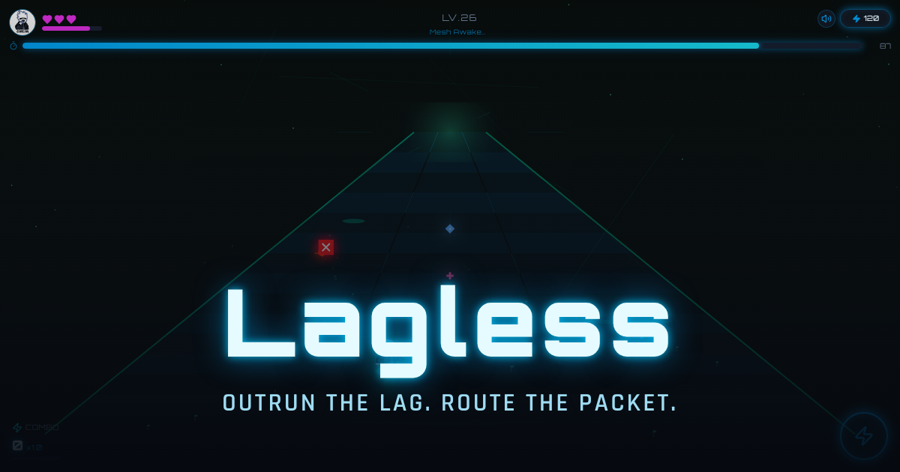
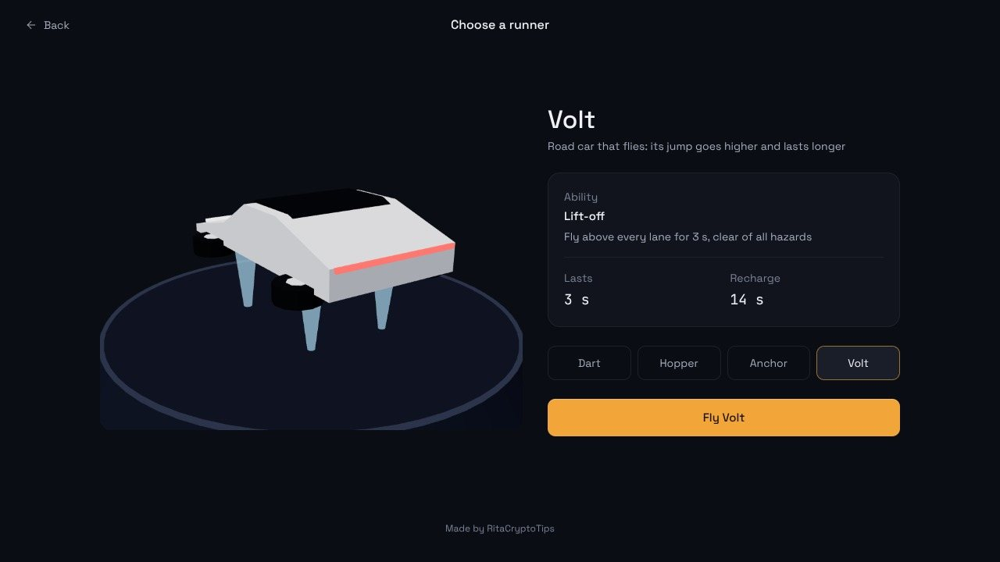
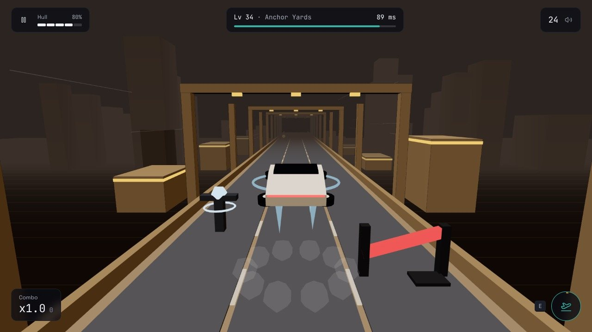
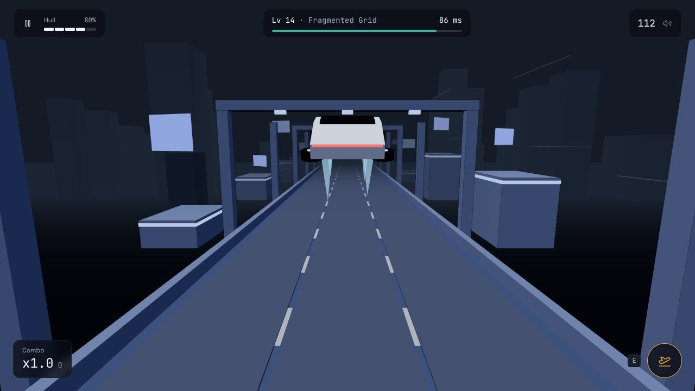
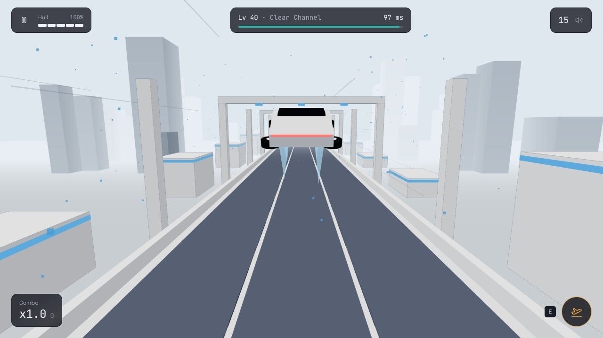

# Lagless

A 3D three-lane runner you play in the browser. Race a hover craft, or a car that flies, down a failing network: dodge hazards, ride the relay lanes that refill your latency budget, and climb through five worlds to level 50.

**[Play it now](https://lagless-inky.vercel.app)** · free, no install, works on desktop and phone



## Contents

- [Gameplay](#gameplay)
- [Controls](#controls)
- [Runners](#runners)
- [Worlds](#worlds)
- [Features](#features)
- [Screenshots](#screenshots)
- [Getting started](#getting-started)
- [Project structure](#project-structure)
- [How it works](#how-it-works)
- [Built with AI](#built-with-ai)
- [Roadmap](#roadmap)
- [Credits](#credits)
- [License](#license)

## Gameplay

You are a packet crossing a network that is falling apart. Every run is a race against your **latency budget**, shown in milliseconds:

- The budget drains all the time, and fast on **red congested lanes**. At 0 ms the run times out.
- **Teal relay lanes** and **teal diamonds** refill it and build your combo, which multiplies your score.
- **Hazards** (crates, storm pylons and broken gates) cost hull. **Green crosses** repair it; **amber coins** add score.
- **Collapsing lanes** flicker and sink for a few seconds, then recover as fast lanes.

Each runner has one ability on a cooldown. Checkpoints save from level 10, so a long run is never lost: Retry resumes from the last checkpoint you passed.

## Controls

| Action | Keyboard | Touch |
| --- | --- | --- |
| Switch lane | `←` `→` or `A` `D` | Swipe left or right |
| Jump (Volt: fly) | `Space`, `↑` or `W` | Tap or swipe up |
| Ability | `E` or `Shift` | Ability button, bottom right |
| Pause | Pause button | Pause button |

The game pauses by itself if you switch apps or tabs mid-run.

## Runners

| Runner | Craft | Ability | Lasts | Recharge |
| --- | --- | --- | --- | --- |
| **Dart** | Slim racer | **Overdrive**: double speed and pass straight through hazards | 3 s | 10 s |
| **Hopper** | Twin-pod relay courier | **Hop**: jump 200 m ahead and refill 30 ms of latency | 2 s | 12 s |
| **Anchor** | Heavy hauler | **Clear lanes**: turn every lane back to a fast lane | 4 s | 15 s |
| **Volt** | Road car that flies | **Lift-off**: fly above every lane, clear of all hazards | 3 s | 14 s |

Volt drives on four wheels. When it jumps, the wheels fold flat and four thrusters fire underneath, so its jump goes higher and lasts longer than the others'.

## Worlds

| Levels | World | Character |
| --- | --- | --- |
| 1–12 | **Congestion Zone** | Dusk haze, slow and dense, red static in the air |
| 13–25 | **Fragmented Grid** | Cold night, lanes drop out, panels glitch beside the track |
| 26–32 | **Mesh Awakening** | First light, relay masts linked across the track, combo-friendly |
| 33–39 | **Anchor Yards** | Sodium-lit freight yard, stability zones, high combos |
| 40–50 | **Clear Channel** | The final world: bright, fast, few hazards, hardest hits |

Levels 25 and 39 are boss waves, with denser hazards and a red-framed screen. Finish level 50 to clear the network.

## Features

- **Five 3D worlds** with their own palettes, scenery and ambient effects, blending as you cross from one to the next
- **Four runners** with distinct abilities, including Volt's flight
- **Checkpoints** from level 10, with Retry from the last one passed
- **Daily missions**: four goals that reset at 00:00 UTC; finishing them unlocks a one-time 2-minute preview of Clear Channel
- **Achievements**, a **profile**, and **best runs**, your top 10 scores on this device
- **First-run coaching**: for a player's first runs, relay diamonds and lanes blink, with a short hint, until they've got the idea
- **Procedural audio**: music and effects are synthesised live with the Web Audio API, with no audio files
- **Guest play** or any username, no account needed

## Screenshots

| | |
| --- | --- |
|  |  |
|  |  |

## Getting started

Requires [Node.js](https://nodejs.org) 18 or newer.

```bash
git clone https://github.com/Ritapossible/Lagless.git
cd Lagless
npm ci
npm run dev        # http://localhost:8080
```

| Command | What it does |
| --- | --- |
| `npm run dev` | Start the dev server with hot reload |
| `npm run build` | Production build into `dist/` |
| `npm run preview` | Serve the production build locally |
| `npm test` | Run the unit tests (Vitest) |
| `npm run lint` | Lint with ESLint |

### Deploying

Lagless is a static site. It deploys to [Vercel](https://vercel.com) with no configuration: import the repo and deploy. `vercel.json` routes every path to the app so links like `/runs` work when opened directly. Every push to `main` redeploys.

## Project structure

```
src/
├── game/
│   ├── engine.ts          Game rules and state: movement, spawning, collisions, abilities, levels
│   ├── types.ts           Game state, world and runner definitions
│   ├── playerProgress.ts  Saved progress, checkpoints, trials
│   ├── dailyMissions.ts   Daily missions and reward
│   ├── bestRuns.ts        Top 10 runs on this device
│   ├── relayHint.ts       When to coach new players
│   ├── audio.ts           Procedural music and sound effects
│   └── three/             3D view
│       ├── GameRenderer.ts  Track, hazards, pickups, camera, world palettes
│       ├── craft.ts         The four runners, built from primitives
│       ├── effects.ts       Per-world atmosphere and ability effects
│       └── CraftStage.ts    Turntable on the runner select screen
├── components/            HUD, overlays, runner select, shared UI
├── pages/                 Home, Play, Missions, Best runs, Profile
└── test/                  Unit tests
```

## How it works

- **Engine and view are separate.** `engine.ts` owns every rule and returns a new `GameState` each frame. The 3D view in `src/game/three/` only reads that state and draws it, so gameplay can be tested without a browser and the renderer can change without touching the rules.
- **No art files.** Every craft, hazard and building is made from simple shapes with flat shading and edge lines, so the game loads fast and stays small.
- **No backend.** Progress, missions and best runs live in the browser's `localStorage`. Saves from earlier versions are migrated on load.
- **Tested.** 25 unit tests cover the engine (including each runner's jump physics and Lift-off), checkpoints and retry, the one-time trial, daily missions, best runs and save migrations.

Built with React, TypeScript, Vite, Tailwind CSS and [Three.js](https://threejs.org).

## Built with AI

AI was used throughout development:

- **[Lovable](https://lovable.dev)** generated the original game from prompts: the game engine, the first 2D canvas renderer, the interface and the progression systems.
- **[Claude Code](https://claude.com/claude-code)** made the November 2026 updates:
  - the Three.js renderer, the five 3D worlds and the four runners, built in code from primitives
  - Volt, the flying car, and per-runner jump physics
  - per-world atmosphere and ability effects
  - an interface redesign guided by the [unslop](https://github.com/heydamir/unslop) skill
  - checkpoints with Retry, the one-time trial, first-run coaching, usernames and best runs
  - bug fixes, tests, this README and the trailer

## Roadmap

What comes next, roughly in order:

1. **Global leaderboards**: a small backend so players compete across devices, with daily and all-time boards and per-runner rankings.
2. **Daily seeded run**: one shared track layout per day, so everyone faces the same hazards and scores compare fairly.
3. **Ghost replays**: race a faint copy of your best run, or a friend's.
4. **More runners and worlds**: new abilities, and new hazard types per world, such as moving gates and lanes that merge.
5. **Controller and accessibility support**: gamepad input, remappable keys, reduced motion, colour-blind lane palettes and adjustable speed.
6. **Installable app**: offline play as a PWA, with haptics on phones.
7. **Sound**: a fuller soundtrack per world that reacts to your combo and latency budget.

## Credits

- Game by [RitaCryptoTips](https://x.com/RitaCryptoTips)
- Interface redesign guided by [unslop](https://github.com/heydamir/unslop) by Damir Sokolovsky, licensed CC BY 4.0
- Fonts: [Space Grotesk](https://fonts.google.com/specimen/Space+Grotesk) and [JetBrains Mono](https://fonts.google.com/specimen/JetBrains+Mono), SIL Open Font License
- 3D: [Three.js](https://threejs.org), MIT License; icons: [Lucide](https://lucide.dev), ISC License

## License

Lagless is released under the [MIT License](LICENSE). © 2026 Rita Egwuatu.

Third-party libraries, fonts and the unslop guidance keep their own licences, listed under [Credits](#credits).
